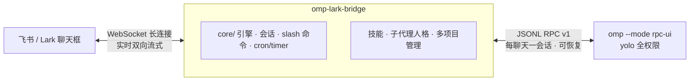

# omp-lark-bridge

> **在飞书里,直接指挥最强的开源编码智能体。**
> 把 omp 接到飞书/Lark —— 随时随地,一句话干活:改代码、跑任务、定时巡检、拉周报。实时流式输出,全程无需打开终端。


---

## 一句话

omp-lark-bridge 是一个**消息桥**:让 omp(那个极强力的编码 agent harness)住进你的飞书。你像发消息一样使用它 —— 不用开终端、不用管环境,它自己带着完整的 AGENTS.md、技能、会话记忆在工作。

## 能做什么

- **实时流式对话**:长连接 WebSocket,回复像聊天一样一行行流出来,不是等一整屏。
- **永不丢失的会话**:每个聊天一个 `omp --mode rpc` 长会话,可 `在新/旧会话间切换`,重启服务也能接着聊(会话文件持久化,重启续上同一对话)。
- **yolo 全权限**:`--approval-mode yolo` 直接干,不打断你。`.omp` 会话目录隔离,不污染本机日常环境。
- **定时任务全家桶**:`/cron` `/timer` 分页看板 —— 定时巡检、日报草稿、定时发图,一键 `立即运行`。新任务**默认以 goal 模式执行**(RPC `goal create`):按目标自主推进,不靠聊天恢复。
- **指派专用子代理**:内置 `scout` / `reviewer` / 自定义人格,让正确的"员工"干正确的活。
- **技能即命令**:`/skills` 列出会话可用技能,每个技能都是一个斜杠命令 —— `/技能名 参数` 原样转给 omp 原生技能协议。
- **多项目隔离**:每项目 = 独立 omp agent + 工作目录 + 独立飞书应用,配置、会话、任务互不干扰。
- **后台常驻**:一键 `daemon install`,systemd / launchd 守护,开机自启,日志自动轮转。

## 长这样




> **首次安装？** 看 [INSTALL.md](./INSTALL.md)——面向 agent 的分步手册：跨
> Linux/macOS/Windows 的编译、扫码、daemon 自启，以及大陆网络镜像、

## 快速开始

```bash
make build                            # 编译出 omp-lark-bridge
./omp-lark-bridge feishu setup --project my-project   # 交互式完成飞书应用接入
```

或纯配置文件流:

```bash
cp config.example.toml config.toml    # 填 app_id / app_secret / work_dir
./omp-lark-bridge --config config.toml
./omp-lark-bridge daemon install --work-dir .
```

> 还没装二进制?技能目录自带一键安装:`bash install.sh` 自动下载匹配

- **后台管理看板默认开启**：服务启动后自带 `http://localhost:31990/`（默认端口
  `31990`，`config.toml` 的 `[management]` 段可改，如 `port` / `token` / `host`）。
  看板提供定时任务、会话、文件浏览与 REST API（`/api/v1/*`），进入需填 `token`
  （默认 `"1"`，建议改掉）。`[management] enabled = false` 可关闭。
- **ompweb Web 工作台随服务强绑定**：`daemon install` 会确保 ompweb 已装
  （缺失时 `npm install -g @kahme247/ompweb`）并让 `omp-lark-bridge.service`
  `Wants/After` `ompweb.service`，由 systemd 与 OLB 一起拉起
  （`http://localhost:30177/`）。看板右上角「ompweb ↗」直达，会话可在 ompweb
  继续。`[ompweb] enabled = false` 可关闭（不推荐）。

## 在聊天框里能玩什么

| 类 | 命令 |
|---|---|
| 会话 | `/new` `/switch` `/list` `/history` `/delete` `/retry` |
| 智能体 | `/model` `/memory` `/shell` `/skills` |
| 定时 | `/cron` `/timer`(分页看板 + 立即运行/静音/删除) |
| 系统 | `/help` `/status` `/doctor`、`send` / `sessions` / `cron` 等 CLI 等价物 |

权限打断永不出现(yolo);想停就用 `/stop`。

## 飞书端细节

- 富文本卡片、inline 按钮、图片/文件、流式预览、紧凑进度
- `/` 面板自动同步可用命令(`application/v7/app_slash_commands`),过期命令自动清理
- 对话默认简体中文;agent 无法提供的命令(`/` 面板、`/help`、`/commands`)一律隐藏

## Cron & timer 看板

`/cron` `/timer` 渲染分页卡片(每页 8 条):状态徽标(`✅`/`❗`/`⏸`)、下次运行倒计时、上次运行、连续失败次数与最后错误。按钮分两行排布:行 1 **立即运行 · 启用/停用 · 新建会话/复用会话**,行 2 **静音/取消静音 · 删除**;底部在 *仅本聊天* 与 *项目全部任务* 之间切换。

### 会话策略(goal 模式默认开启)

每个任务携带 `goal_mode`(默认开):开启 = 以 omp goal 模式执行,新任务强制全新会话、按目标自主推进,执行前经 omp RPC `goal create` 建目标——`--no-goal` 关闭、`cron edit <id> goal_mode false` 改回。还需要 `session_mode`:

| 值 | 行为 |
|---|---|
| `""` / `reuse`(默认) | 每次触发都在创建任务时的那个会话里继续 —— 同一任务永远是同一会话 |
| `new_per_run` | 每次触发新建会话(触发消息落在 `<session>#cron:<id>` 侧会话) |

创建时指定(`/cron add --new-session 0 9 * * * 每日报告`,或 CLI `cron add --session-mode new-per-run`),之后用 `/cron session <id> <reuse\|new>` 或卡片按钮改。失败任务在**首次失败**及**每第 5 次连续失败**时推送失败卡片,成功后归零;静音任务保持安静。

## 系统提示注入

每个 live omp 会话以 `--append-system-prompt` 注入一份精简的桥能力简报(每会话仅一次),中文,告诉 agent 用 `omp-lark-bridge send` / `cron` / `timer` 与 `/skill:<name>` 调用能力;不会重复技能列表(omp 自己会发现)。每项目可用 `append_system_prompt = "…"` 覆盖,设为空串则完全禁用注入。

桥同时把自身目录前置到子进程 PATH(`prependSelfDirToPath`),所以即使桥不在系统 PATH,agent 也能解析 `omp-lark-bridge`(linux / windows x64 通用)。

## 它是怎么工作的

`agent/omp` 为每个聊天拉起 `omp --mode rpc-ui --approval-mode yolo --session-dir <data>/omp-sessions/<session> --cwd <work_dir>`,说 omp 的 JSONL RPC 协议(v1):

- `new_session` / `switch_session` 开始或恢复;恢复身份 = omp 会话 *文件*(`get_state.sessionFile`),存为 `Session.AgentSessionID`,守护进程重启后继同一对话;`set_model` 应用配置模型
- `prompt` → 流式 `message_update`(文本/思考增量)、`tool_execution_start/end`,再 `prompt_result`(completed/aborted/error)
- `/stop` 发 `abort`;会话生命周期(new/switch/close)映射到 `session_settled`
- `set_ask_dialog` 开启,`ask` 工具的对话框以 `extension_ui_request` 到达,渲染成聊天问题卡片(单选按钮、多选按数字回复),答复以 `extension_ui_response{answers}` 回写(含 `select` 兜底与自由文本 `customInput`)
- 图片/文件落盘,以路径形式进 prompt

### goal 模式执行路径

omp 拒绝 `--goal` 启动参数配 `--mode rpc-ui`;桥因此在会话启动后发 RPC `goal`(op: `create`, objective = 任务 prompt)—— 与交互式 `/goal` 同一生命周期,但**best-effort**:若 omp `goal.enabled` 关闭或已有活跃目标,`create` 失败仅告警,任务降级为普通会话继续跑,不会挂起。

## 项目结构

```
cmd/omp-lark-bridge      入口 · CLI · daemon · 插件注册
core/                   引擎 · 接口 · i18n · 卡片 · 会话 · cron/timer
agent/omp               omp harness 适配器(RPC 长会话 · goal 通道)
platform/feishu         飞书/Lark 平台适配器
daemon/                 systemd / launchd 服务
```

- **内核干净**:`core/` 不 import 任何 agent/platform;agent 与平台经注册表 `RegisterAgent` / `RegisterPlatform` 插件式接入 —— 加新平台/新 agent 不动内核。
- **可裁剪编译**:`make build EXCLUDE=feishu` 或 `AGENTS=omp PLATFORMS_INCLUDE=feishu`(tags `no_omp` / `no_feishu`)。
- **用户视角测试**:`core/cuj_test.go` 的 Critical User Journey 测试从"用户看到什么"出发,保证真流程不坏。

## 构建与测试

```bash
make build         # 编译 omp-lark-bridge
make test-full     # go test -race ./...
go test ./...      # 快速验证
make release-publish   # 全平台产物发布到 GitHub Release(新机器 install.sh 自动拉取)
```

## Hub:中心 + 节点（OMP Web 反向隧道）

把多台机器接成一个**中心 + N 节点**：

- **中心**：唯一公网入口，提供管理控制台、节点配对和 OMP Web relay。
- **节点**：只主动出站 443 建立 WSS 隧道；不需要公网端口，也不需要为每个节点单独建 Cloudflare Tunnel。
- **节点本地自治**：中心宕机时，节点本机的 OMP Web、会话、定时任务、飞书仍继续运行。

节点数量不预设。控制台「节点」页点「添加节点」生成一次性命令，节点执行
`hub pair` 即可接入；不再需要时点「移除」。每个节点自动使用
`omp-<device_token>.<domain>` 的 host，由 `*.example.com` 泛解析 + relay 动态路由，
无需预建 `pc1..pc4` 之类的固定槽位。

### 两种模式

- **server**：中心；`[hub] mode = "server"`。注册 `/hub/*`，启动 relay（默认
  `127.0.0.1:31991`），维护 `hub-devices.json`。
- **client**：节点；`[hub] mode = "client"`。用配对码换取 token + secret，主动向中心
  建立 WSS 隧道，把本机 OMP Web 通过隧道暴露给中心。

旧的控制面仍然保留：client 每约 60 秒 `POST /api/v1/hub/register` 上报
agent/session 元数据，并拉取中心投递的 run/edit op。**OMP Web 页面走反向隧道，
两条链路互不替代**：inventory 只负责列表计数，页面访问以隧道是否存在为准。

### 添加节点

1. 中心控制台「节点」→「添加节点」，填 `device_token`（如 `pc5`）和名称；host 留空。
2. 中心生成 10 分钟有效的一次性码，并自动推导 `omp-pc5.example.com`。
3. 在节点执行控制台给出的命令：

   ```bash
   omp-lark-bridge hub pair https://bridge.example.com <CODE> --name zte-linux
   ```

4. 把命令输出的 `[hub]` / `[ompweb]` 合并进节点 `config.toml`，重启节点服务。
5. 控制台节点显示在线；浏览器打开 `https://omp-pc5.example.com/`。

> 配对命令必须从公网控制台生成。不要在节点上用 `127.0.0.1:31990` 生成，
> 否则命令里的 `server_url` 会是节点不可达的本地地址。

### 配置

中心：

```toml
[hub]
enabled = true
mode = "server"
secret = "用 openssl rand -hex 32 生成的长随机串"
relay_port = 31991
node_host_suffix = "example.com"   # 留空则从 [ompweb] public_url 推导

[ompweb]
public_url = "https://omp-center.example.com"
```

节点（配对命令会给出完整片段）：

```toml
[hub]
enabled = true
mode = "client"
state_file = "/home/you/.omp-lark-bridge/hub-client.json"

[ompweb]
public_url = "https://omp-pc5.example.com"
```

`hub-client.json` 含中心共享 secret，创建权限保持 `0600`；不要提交、不要发群。

### Cloudflare

- `bridge.example.com` → `127.0.0.1:31990`（控制台）
- `omp-center.example.com` → `127.0.0.1:30177`（中心 OMP Web）
- `*.example.com` → `127.0.0.1:31991`（节点 relay）
- 末尾 `http_status:404`
- 泛解析 CNAME `*.example.com` 指向同一个 tunnel；精确记录优先。

> 安全：relay 只按 host 路由到已配对节点，**不校验访问者**。节点 OMP Web 必须设置
> 自己的密码（`OMP_WEB_PASSWORD_HASH`）或用 Cloudflare Access 保护。管理 token、
> hub secret、配对码都不要外传。中心 `31990` 建议只监听 `127.0.0.1`，由 cloudflared 转发。

完整安装（中心、Linux/Windows 节点、中兴设备、动态移除、排障）见
**[docs/HUB-NODES.md](./docs/HUB-NODES.md)**。

## 授权

MIT License,见 [LICENSE](./LICENSE);派生声明见 [NOTICE](./NOTICE)。本项目
派生自 [chenhg5/cc-connect](https://github.com/chenhg5/cc-connect)(MIT)——
上游版权与许可声明已保留。

## 致谢

本项目站在 [chenhg5/cc-connect](https://github.com/chenhg5/cc-connect) 的肩膀上——
一个把编码 agent 接入 IM 的开源桥梁。感谢 **chenhg5** 及其贡献者:引擎内核、
可插拔的平台/agent 架构、卡片与会话设计,都让 omp-lark-bridge 得以快速落地。
Kudos, cc-connect ❤️
